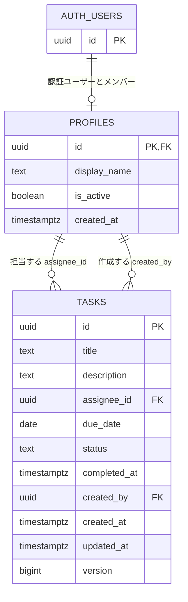

# タスク管理アプリ データベース設計書

- 作成日：2026年11月16日
- 対象：単一チーム向け初期リリース
- データベース：Supabase PostgreSQL
- 関連：[要件定義書](requirements.md)
- 状態：マイグレーションと接続コードを実装済み。ローカルPostgreSQLで検証済み。実Supabaseプロジェクトへの適用は未実施。

## 1. 全体構成

アプリ独自のテーブルは、メンバーを管理する `public.profiles` とタスクを管理する `public.tasks` の2つとする。認証情報はSupabase管理の `auth.users` を利用する。



認証ユーザーが存在するだけではアプリを利用できない。有効な `profiles` 行が存在することを利用条件とする。初期リリースではチーム・プロジェクトのテーブルを作成しない。

## 2. メンバーテーブル：public.profiles

| カラム | PostgreSQL型 | NULL | 初期値 | 制約・意味 |
|---|---|---|---|---|
| id | uuid | 不可 | なし | 主キー。auth.users.idへの外部キー |
| display_name | text | 不可 | なし | 前後の空白を除いた表示名。1〜100文字 |
| is_active | boolean | 不可 | false | 利用許可。管理者が明示的に有効化 |
| created_at | timestamptz | 不可 | now() | 作成日時 |

- 名前の重複は許可し、識別には常にUUIDを使用する。
- メールアドレスやパスワードは複製せず、Supabase Authで管理する。
- `id` の外部キーは `ON DELETE RESTRICT` とする。通常の退職・利用停止は `is_active = false` で対応する。
- 管理者が招待したAuthユーザーのIDに対応する行を作成し、表示名の設定と有効化を行う。未承認のユーザー情報から自動的に有効なメンバーを生成しない。
- アプリ利用者は自分自身を含め、メンバーを登録・編集・削除できない。
- 無効なメンバーの名前も、既存タスクの担当者・作成者表示のため、有効なメンバーには参照を許可する。

## 3. タスクテーブル：public.tasks

| カラム | PostgreSQL型 | NULL | 初期値 | 制約・意味 |
|---|---|---|---|---|
| id | uuid | 不可 | gen_random_uuid() | 主キー |
| title | text | 不可 | なし | 前後の空白を除いて1〜100文字 |
| description | text | 可 | NULL | 最大5,000文字、プレーンテキスト |
| assignee_id | uuid | 不可 | なし | profiles.idへの外部キー、担当者1名 |
| due_date | date | 不可 | なし | 期限の日付。過去日も許可 |
| status | text | 不可 | 'todo' | 'todo' / 'done'のみ |
| completed_at | timestamptz | 可 | NULL | 完了日時 |
| created_by | uuid | 不可 | 登録関数でauth.uid()を設定 | profiles.idへの外部キー、変更不可 |
| created_at | timestamptz | 不可 | now() | 作成日時、変更不可 |
| updated_at | timestamptz | 不可 | now() | 最終更新日時 |
| version | bigint | 不可 | 1 | 更新ごとに1加算。1以上 |

`assignee_id` と `created_by` の外部キーはともに `ON DELETE RESTRICT` とし、メンバー削除によるタスクの消失を防ぐ。タスクの物理削除・論理削除は初期リリースでは提供しない。

### データ制約

- タイトルは登録・更新関数で前後の空白（全角空白を含む）を正規化して保存する。DBのCHECKでも、保存値が正規化済みで1〜100文字であることを検証する。正規化規則はアプリとDBで統一する。
- 詳細説明の空文字はNULLに統一し、`char_length(description) <= 5000` をCHECKで検証する。
- `status IN ('todo', 'done')`、`version >= 1` をCHECKで検証する。
- `status = 'todo'` の場合は `completed_at IS NULL`、`status = 'done'` の場合は `completed_at IS NOT NULL` とするCHECKを設ける。
- 担当者の有効性は他テーブルの状態に依存するため、CHECKではなく書き込み関数内で検証する。
- 日時・作成者・版はDB側で決定し、利用者から指定させない。

## 4. 状態・期限・日時のルール

| 操作 | status | completed_at |
|---|---|---|
| 新規登録 | todo | NULL |
| 未完了から完了 | done | DBの処理時刻 |
| 完了から未完了 | todo | NULL |
| 完了のまま内容編集 | done | 既存値を保持 |
| 未完了のまま内容編集 | todo | NULL |

日時は `timestamptz` で時点として保持し、DB接続のタイムゾーンはUTC、画面表示はAsia/Tokyoとする。期限は `date` とし、時差による日付ずれを避ける。

期限超過は保存カラムを設けず、次の式で判定する。日付が変わってもデータ更新は不要。

```sql
status = 'todo'
AND due_date < (CURRENT_TIMESTAMP AT TIME ZONE 'Asia/Tokyo')::date
```

期限当日と完了済みタスクは期限超過に含めない。アプリ側でも同じ日本時間の基準を使う。

## 5. 認証・認可と書き込み経路

### 権限表

| 利用者 | メンバー参照 | タスク参照 | 登録・更新 | 削除・メンバー管理 |
|---|---|---|---|---|
| 未認証 | 不可 | 不可 | 不可 | 不可 |
| 未登録・無効なメンバー | 不可 | 不可 | 不可 | 不可 |
| 有効なメンバー | 全員分可 | 全件可 | 専用RPC経由のみ可 | 不可 |
| 運用管理者 | 管理経路で可 | 管理経路で可 | 管理経路で可 | 運用手順に従う |

### RLSとテーブル権限

- 両テーブルでRLSを有効にし、`authenticated` に必要なSELECTだけを許可する。`anon` には許可しない。
- SELECTポリシーは、JWTのユーザーIDに対応するメンバーが現在有効かをDBで照合する。JWTに保存した有効フラグだけに依存しない。
- 有効性確認用の非公開ヘルパーを `private` スキーマに置く。profilesのRLSからprofilesを通常権限で再照会すると再帰するため、ヘルパーは管理された所有者の `SECURITY DEFINER` とする。呼出者自身の有効性だけを返し、任意のユーザー情報を取得させない。
- `private` はAPIの公開対象スキーマに含めず、ヘルパー呼び出し権限もポリシー評価に必要な範囲に限定する。
- 一般利用者のINSERT・UPDATE・DELETE権限を明示的に取り消す。SELECTだけでなく関数のEXECUTEも、Supabaseのデフォルト権限を確認して明示的に設定する。
- 通常の書き込みは専用RPCのみとする。Next.jsのサーバーから利用者のJWTを付けて呼び出し、管理者用キーは使わない。

### 専用RPC

| 関数 | 利用者が渡す値 | 戻り値 |
|---|---|---|
| create_task | title、description、assignee_id、due_date | 作成後のタスク |
| update_task | id、expected_version、title、description、assignee_id、due_date、status | 更新後のタスク |

`update_task` は編集画面の保存と一覧の完了切り替えに使用する。完了切り替え時も取得済みの版と内容を渡し、競合したら再取得する。

RPCは `SECURITY DEFINER` を使うため、RLSに任せず関数自身で毎回認証・有効性・入力・担当者を検証する。所有者は管理下のロール、`search_path` は空に固定し、テーブル・関数名をスキーマ修飾する。動的SQLは不要。EXECUTEはPUBLIC・anonから取り消し、authenticatedだけに許可する。

有効な担当者を検証するのは新規登録時と担当者変更時。担当者が無効になった既存タスクについて、担当者を変えずに内容の編集や完了操作をすることは許可する。

### 無効化との同時実行

書き込み関数は、操作する本人と新たに割り当てる担当者のprofiles行を、IDの一定順で `FOR SHARE` ロックして有効性を確認する。同一人物なら一度だけロックする。これにより、有効性確認から保存までの間に無効化が割り込むことを防ぐ。

無効化処理は対象profiles行を更新する。進行中の書き込みが先にロックした場合はその終了を待つ。無効化のコミット後に始まる操作は、既存セッションでも拒否する。すでに画面に表示・送信済みの情報を回収する機能ではない。

## 6. 同時編集の競合検出

1. 読み込み時に `version` を取得する。
2. 更新RPCに `expected_version` と編集内容を渡す。
3. 認可・入力検証後、次の条件で原子的に更新する。
4. 0件なら保存成功にせず、対象なしまたは競合として扱う。
5. 競合時は入力を保持し、最新データの再取得を促す。自動上書きはしない。

以下は競合制御部分の概念SQLであり、認可・入力検証・完了日時の処理を省略している。

```sql
UPDATE public.tasks
SET title = p_title,
    description = p_description,
    assignee_id = p_assignee_id,
    due_date = p_due_date,
    status = p_status,
    updated_at = clock_timestamp(),
    version = version + 1
WHERE id = p_id AND version = p_expected_version
RETURNING *;
```

この条件をRPC内部で必須にすることで、画面以外からの呼び出しでも版の照合を省略できない。対象なしと競合を区別する場合も、認可済みの処理内でのみ照会する。競合の判定は先行するSELECTだけで済ませず、UPDATEの条件で保証する。

## 7. 一覧取得とインデックス

基本の並び順は `due_date ASC, created_at DESC, id ASC`。1ページ50件とする。初期規模ではページ番号によるLIMIT / OFFSET方式を採用し、件数が増えた場合はカーソル方式を検討する。

| インデックス | 対象カラム | 用途 |
|---|---|---|
| profiles_pkey | id | ユーザー照合・参照 |
| tasks_pkey | id | 詳細取得・更新 |
| tasks_status_due_idx | status, due_date ASC, created_at DESC, id ASC | 未完了・完了一覧 |
| tasks_assignee_status_due_idx | assignee_id, status, due_date ASC, created_at DESC, id ASC | 担当者＋状態の絞り込み、担当者外部キーの参照 |
| tasks_created_by_idx | created_by | 作成者外部キーの参照 |

状態「すべて」や担当者だけの検索は、初期規模では必要に応じてソートする。実データに近い10,000件で `EXPLAIN (ANALYZE, BUFFERS)` と応答時間を確認し、追加インデックスは測定に基づいて判断する。

一覧は詳細説明を除く必要な列を取得し、担当者名を結合する。profilesへの外部キーが2本あるため、Supabaseの埋め込み取得ではassignee_id側の外部キーを明示する。外部キー制約名はマイグレーションで固定する。

## 8. 運用・マイグレーション方針

- テーブル・制約・インデックス・関数・権限・RLSをSupabaseマイグレーションで版管理する。
- 開発・テスト・本番は分離し、テストデータに実際の社内情報を使わない。
- 招待、profiles登録、有効化までを管理者の手順として定義する。途中で失敗した場合は有効化せず、管理者が状態を確認して再実行する。
- 通常の利用停止は論理的な無効化のみとし、Authユーザーやprofilesを削除しない。将来の個人情報削除は、担当者・作成者の保持方針を別途設計する。
- 初期リリースでは更新者の記録や変更履歴を保存しない。`created_by` は作成者のみを示し、`updated_at` は最終更新時刻のみを示す。
- バックアップと復元の可否・保存期間は契約プランに依存するため、本番運用前に復元手順を確認する。

## 9. 実装時の検証項目

- 未認証・未登録・無効メンバーに対するSELECTとRPCを拒否できる。
- profilesのRLSが再帰せず、有効メンバーだけが担当者名を取得できる。
- 直接のINSERT・UPDATE・DELETE、メンバーの自己有効化、匿名RPC実行を拒否できる。
- 空白のみのタイトル、文字数超過、不正な状態・日付・担当者を拒否できる。
- 登録時の作成者・日時・版を利用者が偽装できない。
- 完了・再開・完了後の編集で、完了日時がルールどおりに変わる。
- 同じ版を使う2つの並行更新は片方だけが成功し、もう片方が競合する。
- 担当者の無効化後も既存タスクが残り、内容の変更・再割り当てができる。
- 無効化と登録・更新を並行させても、定義したロックと有効性の検証が機能する。
- 日本時間の日付境界で期限超過の判定が正しい。
- フィルター・並び順・51件以上のページ移動が正しい。

この文書のSQLは設計説明用であり、実行可能な完全版DDLではない。実装済みDDLは [マイグレーション](../supabase/migrations/202611160001_initial.sql) を参照。PostgreSQLでの権限・RLS・RPCテストとAPIの結合テストを用意している。実Supabaseへの適用・Authとメールの確認は [接続手順](supabase-setup.md) に従って別途実施する。
