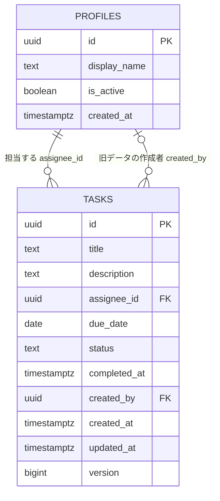

# タスク管理アプリ データベース設計書

- 更新日：2026年11月16日
- 構成：Supabase PostgreSQL、ログイン不要の単一共有ワークスペース
- ユーザー指定：URLを知っている人が誰でも閲覧・編集できる
- 状態：接続コード・追加マイグレーションを実装。実Supabaseへの適用は未実施。

## テーブルの関係



担当者と利用者アカウントは別物であり、担当者の登録にAuthユーザーは不要。ログインや匿名Authセッションの発行は行わない。

## public.profiles

| カラム | 型 | NULL | 初期値・制約 |
|---|---|---|---|
| id | uuid | 不可 | 主キー、gen_random_uuid() |
| display_name | text | 不可 | 前後の空白を除いた1〜100文字。重複可 |
| is_active | boolean | 不可 | false。新規割り当ての可否 |
| created_at | timestamptz | 不可 | now() |

管理者が担当者を登録・変更する。一般利用者は全担当者を参照可能。停止済み担当者も既存タスクの表示のため参照可能とする。is_activeは利用者のアクセス権限には使わない。Authユーザーへの外部キーは追加マイグレーションで解除する。

## public.tasks

| カラム | 型 | NULL | 初期値・制約 |
|---|---|---|---|
| id | uuid | 不可 | 主キー、gen_random_uuid() |
| title | text | 不可 | 正規化した1〜100文字 |
| description | text | 可 | 最大5,000文字、空文字はNULL |
| assignee_id | uuid | 不可 | profiles.idへの外部キー、ON DELETE RESTRICT |
| due_date | date | 不可 | 有限の日付、過去日可 |
| status | text | 不可 | todo / done、初期値todo |
| completed_at | timestamptz | 可 | done時のみ必須 |
| created_by | uuid | 可 | 旧データの作成者。新規登録はNULL、更新で変更不可 |
| created_at | timestamptz | 不可 | now()、更新で変更不可 |
| updated_at | timestamptz | 不可 | 保存時にDBで更新 |
| version | bigint | 不可 | 1から開始し保存ごとに加算。JavaScriptの安全な整数範囲 |

created_byの既存値は保持し、profilesへの外部キーも維持する。新規タスクは操作した人を特定できないためNULLとする。担当者を作成者とみなさない。認証情報・メールアドレス・パスワードをアプリのテーブルに保存しない。

## 権限と書き込み

両テーブルのRLSは有効のままとする。

| 操作 | anon / authenticated | 管理者 |
|---|---|---|
| タスク・担当者の参照 | 全件可 | 可 |
| タスクの登録・更新 | 専用RPCのみ可 | 可 |
| テーブルへの直接INSERT / UPDATE / DELETE | 不可 | 可 |
| 担当者の登録・変更 | 不可 | 可 |

RLSのSELECTポリシーはtrueで、全データを公開する。アプリは常にサーバー側のPublishable key / anon keyで接続し、利用者のCookieやJWTを引き継がない。service_roleやSecret keyは使用しない。URLや公開用キーを秘密の認証手段とはみなさない。

公開RPCはSECURITY DEFINER、空のsearch_path、スキーマ修飾したSQLを使う。PUBLICの実行権限を取り消し、anon / authenticatedに必要な関数だけを許可する。

- create_task：title・description・assignee_id・due_dateを受け取る。有効担当者のみ割り当て可能。作成者・日時・初期状態・版はDBが決定。
- update_task：id・expected_versionと編集内容を受け取る。担当者変更時は有効性を検証。停止済み担当者がそのままの既存タスクは編集可。
- 担当者のprofiles行をFOR SHAREでロックし、新規割り当てと担当停止の同時実行を制御する。
- タスク行をFOR UPDATEでロックし、UPDATEにも版の条件を付ける。同じ版の同時更新は片方だけが成功し、もう一方はPT409で拒否。
- 直接のテーブル更新を許可しないため、RPCの入力検証や版の照合を回避できない。

## 完了・期限・一覧

未完了→完了で完了日時を設定する。完了のまま内容編集する場合はその日時を保持し、未完了への復帰でNULLにする。日時はtimestamptzで保存し日本時間で表示する。期限はDATEで保持する。

期限超過は次の式で計算し、専用の保存カラムは持たない。

```sql
status = 'todo'
AND due_date < (CURRENT_TIMESTAMP AT TIME ZONE 'Asia/Tokyo')::date
```

一覧の並び順は `due_date ASC, created_at DESC, id ASC`。50件ずつ表示する。状態＋期限、担当者＋状態＋期限、作成者のインデックスを用意する。初期想定10,000件で測定し、必要時にDB集計・サーバー側ページングへ変更する。

## マイグレーションと検証

1. [初期構造](../supabase/migrations/202611160001_initial.sql)
2. [公開共有モードへの移行](../supabase/migrations/202611160002_public_workspace.sql)

初期構造だけのプロジェクトには2番目を追加適用する。既存データは削除しない。担当者のAuthへの依存を解除し、created_byをNULL可にする。旧データの作成者・担当者・版は保持する。

PostgreSQLで匿名参照・RPC実行・直接更新の拒否・入力制約・完了日時・同時更新・担当停止との競合・既存データ保持をテストする。実際の接続手順は [Supabase接続手順](supabase-setup.md) を参照。
